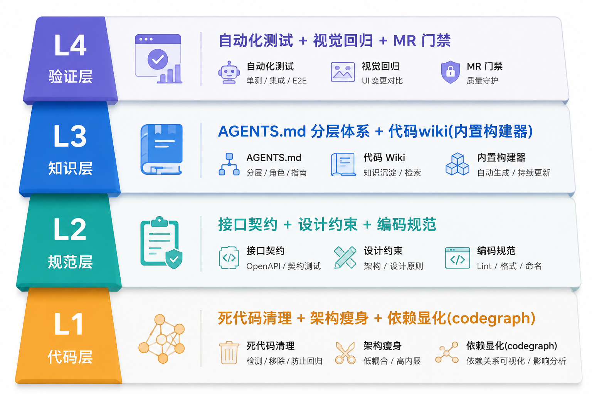
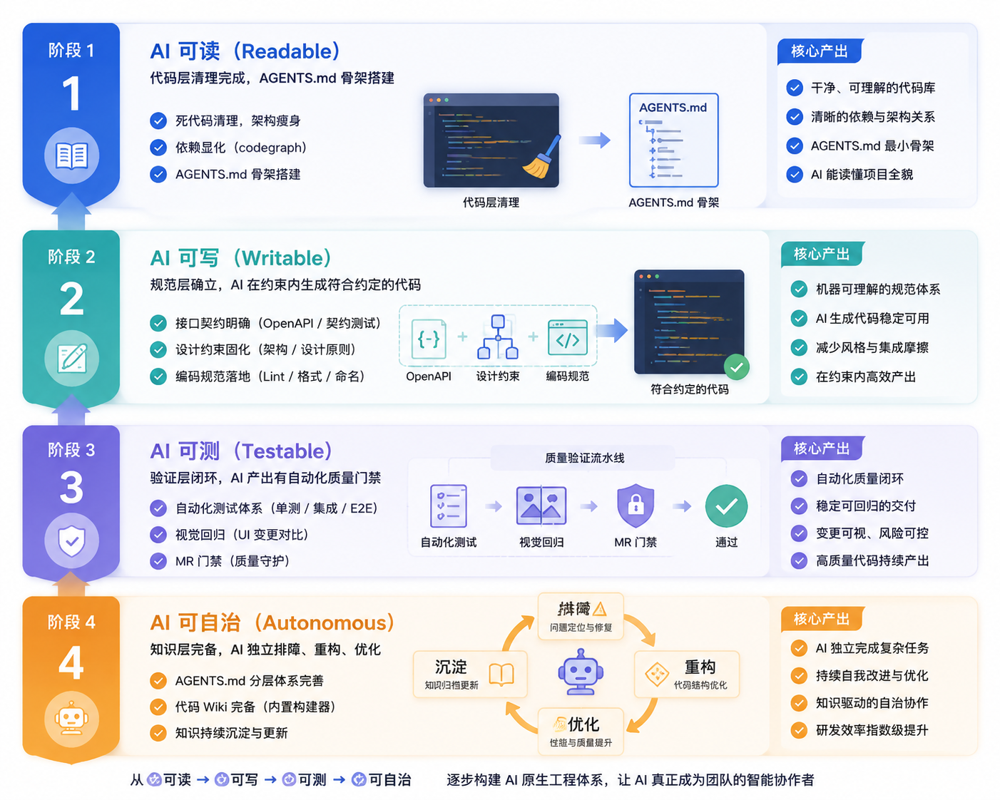

# Legacy Context Builder

> 让 AI 真正读懂并安全维护你的老项目——为遗留系统（"屎山"）系统性构建 AI 上下文工程。

**Legacy Context Builder** 是一个面向**所有 Coding Agent** 的上下文工程技能——Claude Code、Codex、OpenCode、Cursor、Jules、Amp 都能用。当你接手一个缺文档、缺测试、改造做了一半的历史项目，想让 AI 编程助手帮你维护，却发现它**频繁误改、删错代码、凭空幻觉**时——这个技能用一套系统化的流程，把项目改造成任何 AI 都能可靠读懂、安全修改的状态。

它产出的上下文体系基于 **AGENTS.md 这一跨 Agent 事实标准**（Codex、Cursor、OpenCode、Jules、Amp 等原生读取），而非某个 agent 的私有格式——**搭一次，所有 agent 共享同一套知识**。技能本身以 Skill（`SKILL.md`）形式分发，Claude Code 可自动加载；其它 agent 则把这套流程当作工作指令执行。具体接入见 [快速开始](#快速开始)。

它解决的不是"代码写得不好"，而是 **AI 看不懂现状**。

---

## 目录

- [它解决什么问题](#它解决什么问题)
- [适合谁，什么时候用（以及什么时候别用）](#适合谁什么时候用以及什么时候别用)
- [快速开始](#快速开始)
- [核心：四层上下文工程模型](#核心四层上下文工程模型)
- [两种运行模式](#两种运行模式)
- [它会产出什么](#它会产出什么)
- [几个关键设计决策](#几个关键设计决策)
- [工具集成](#工具集成)
- [能力演进：改造成什么程度算成功](#能力演进改造成什么程度算成功)
- [本技能自身的文件结构](#本技能自身的文件结构)
- [方法论来源与致谢](#方法论来源与致谢)

---

## 它解决什么问题

AI 在新项目上表现惊艳，在遗留系统里却频频翻车。**根因不是模型能力，而是上下文缺口（Context Gap）。**

AI 只能通过静态代码推断意图，而老项目的代码与真实运行态往往存在巨大偏差——关键信息散落在 commit message、口头交接、离职同事的笔记里，AI 拿不到：

| 上下文类型 | 典型缺失 | 对 AI 的影响 |
|---|---|---|
| **业务背景** | 兼容代码对应的历史需求、已下线功能残留 | 误判代码有效性，提出错误删改 |
| **架构契约** | 模块通信协议、状态机约定、接口版本演进 | 生成不符合约定的代码，破坏调用链 |
| **运行时真相** | 哪些分支真实可达、哪些配置已废弃 | 基于静态引用做错误假设，方案无法运行 |
| **技术债务** | 改造做了一半的模块、临时方案转正的副作用 | 在脆弱地基上继续搭建，引发级联故障 |

> **一个真实反面案例（本技能评估时实测到的）。**
> 某个 AI agent 在静态分析时发现 React 的 `I18nProvider`、i18n 初始化配置、`LanguageSelector` 这些文件"没有任何地方 import"，于是判定为死代码并删除。但全仓库有十几个组件在调用 `useTranslation()`。删掉之后——**应用照常启动、没有报错、没有崩溃，但所有 UI 文案退回了原始 key**。这是最危险的一类损坏：静默的、无报错的。
>
> 教训：对 **配置 / Provider / 注册 / 注入** 类符号，"零 import"是常态，不是死信号。必须追"谁在消费它注入的能力"，而不是只数 import。这正是本技能 L1 层的核心安全纪律。

本技能就是来补齐这些缺口、并锁死"误删"这类操作的。

---

## 适合谁，什么时候用（以及什么时候别用）

**适合：**

- 接手了一个缺文档的老项目，想让 AI 帮忙维护
- 已经在用 AI 维护，但它**频繁误改、删错东西、答非所问**
- 想搞清楚仓库里哪些代码是"死的"（看着有引用，其实运行时不可达）
- 想搭一套**多 AI、多人通用**的项目知识体系（不绑死某个 agent）
- 怀疑现有的上下文文档（README / AGENTS.md）已经和代码脱节

**别用（这些场景它不是最优解）：**

- 从零搭建全新项目——你没有"上下文缺口"问题
- 只想单点重构某个函数——直接动手更快
- 只想跑 knip / depcheck 清死代码——那是单一工具，本技能是系统工程

**触发方式**（安装后，对 AI 说出这些意图即可自动命中）：

> 老项目、遗留项目、屎山、接手老项目、历史债、给 AI 补上下文、AI 上下文工程、AGENTS.md、幽灵代码、死代码梳理、上下文过期、文档和代码对不上……

---

## 快速开始

### 1. 安装

技能本身是一组 markdown（主流程 `SKILL.md` + 参考资料 `references/` 与模板 `assets/`），产出的上下文体系基于跨 Agent 标准 AGENTS.md。所以它**面向所有 coding agent**，只是各 agent 的接入姿势不同：

- **Claude Code**：原生自动加载 Skill——把本目录放进 `~/.claude/skills/`（用户级）或项目的 `.claude/skills/`（项目级）。
- **Codex / Cursor / OpenCode / Jules / Amp 等**：这些 agent 原生读 AGENTS.md，技能产出的正是 AGENTS.md 体系；执行时把 `SKILL.md` 当作工作指令交给 agent（粘进对话，或放进 agent 的指令 / 规则目录）即可驱动同一套流程。

```bash
# Claude Code：用户级安装
git clone https://github.com/jidechao/legacy-context-builder ~/.claude/skills/legacy-context-builder
```

### 2. 在目标项目里运行

在你的老项目里打开 coding agent（Claude Code / Codex / Cursor / OpenCode 等），直接用自然语言说：

```
我刚接手了这个项目，是个老项目，想让 AI 帮忙维护。
帮我系统地搭一套 AI 上下文工程。
```

或者显式调用：`/legacy-context-builder`。

技能会先进入 **Phase 0 勘察**，判断这个项目是"从零建设"还是"已有文档需要巡检"，然后给你范围选择，再逐层推进。

### 3. 每个阶段都有人工确认门禁

遗留系统的"运行时真相"和"业务背景"无法靠静态分析获得，必须和人确认。所以技能**不会一口气自动跑完**——每个阶段结束会停下来，把"只有你知道"的问题集中抛给你批量确认，再继续。

---

## 核心：四层上下文工程模型

本技能围绕一个核心原则展开：**下层是上层的基础，不可跨层建设。** 代码层不清，规范层就是空中楼阁；规范层不定，知识层缺乏锚点；验证层不立，AI 产出没有安全网。



| 层级 | 解决什么 | 关键动作 |
|---|---|---|
| **L1 代码层** | 代码与运行态不一致（幽灵代码噪音） | 死代码三层识别 + 架构瘦身 + 依赖图谱 |
| **L2 规范层** | 缺乏约束边界（"怎么做"） | 模块边界 + 接口契约 + 编码规范 + **Karpathy AI 行为准则** |
| **L3 知识层** | 缺乏 Why（"为什么这么做"） | AGENTS.md 分层体系 + 内置代码 wiki 构建器 |
| **L4 验证层** | AI 产出不可信（"做得对不对"） | 测试工程分期 + 视觉回归 + MR 智能门禁 |

### L1 的铁律：只诊断，不删除

这是整个技能最重要的安全纪律。在 L1 阶段，对任何"疑似死代码"**只产出带证据的清理建议，绝不执行删除**。删除权完整留给后续阶段（规范收敛 + 人工确认 + 测试护栏到位）之后再分批执行。

死代码识别走**三层**，而非只看静态引用：

1. **静态扫描**——引用分析 / codegraph 调用图（零入边符号）/ grep 兜底
2. **运行时追踪**——日志埋点 / 覆盖率（遗留项目常缺此基建，缺失则降级）
3. **业务确认**（主战场）——用"预留 vs 废弃"启发式自判，判不了的标 ⏳ 集中问人

> 判定示例（KnowNote 项目）：`RerankCapability` 接口零实现，看似废弃；但源码注释写着"为未来扩展预留，暂未实现"且进了 roadmap → 判定 **预留、保留**。同项目 `ollama-ai-provider` v1 依赖零引用、无预留信号 → 判定 **废弃、进清理建议**。靠这个启发式避免了误删预留接口。

---

## 两种运行模式

技能在 Phase 0 会自动判定项目当前状态，进入对应模式：

### 模式一：首次建设（Full Build）

项目几乎没有上下文文档。走完整 L1→L4 流程，逐层搭建。也可选**快速路径（L1+L3）**——时间有限时先做"清死代码 + 搭 AGENTS.md 骨架"，规范和测试留到以后。

### 模式二：巡检 / 漂移修正（Drift Check）

项目**已经**搭过上下文体系，但一直在改，怀疑文档和代码对不上了。这种情况下技能**不重建**，而是：

1. 用 `git log` / 修改时间圈定变更范围
2. 逐条核对现有文档里的"事实性陈述"（架构契约、已下线清单、构建命令、索引链接）在当前代码里是否还成立
3. 产出 `docs/context-drift-report.md` 漂移报告（过期项 / 缺失项 / 健康项）
4. **就地修正**过期文档，每处修正记录依据（哪个 commit / 哪段代码）
5. 增量刷新代码 wiki（只改被变更波及的页，无变更则不动）

> **建议固化为团队节奏**：每月跑一次巡检。上下文最大的敌人是腐烂。

---

## 它会产出什么

一个改造完成的项目，大致长这样：

```
project-root/
├── AGENTS.md                  # 唯一上下文来源：技术栈+命令+全局规则+索引（~70-90 行）
├── CLAUDE.md                  # Claude Code 入口：仅 @AGENTS.md 导入桩（< 30 行，零内容）
├── openwiki/                  # 内置构建器产出的代码 wiki（任务路由表 + 领域知识）
│   ├── quickstart.md          # 入口：总览 + "改 X 去哪、验什么"的任务路由表
│   └── domain/ architecture/ workflows/ ...
├── docs/
│   ├── context-gap-report.md      # 上下文缺口诊断报告（巡检模式为 context-drift-report.md）
│   ├── runtime-truth.md           # 跨模块硬知识：关键决策/运行时真相/已下线清单/技术债
│   ├── architecture/
│   │   └── dependency-map.md      # 依赖图谱（codegraph 导出 或 手工归纳）
│   ├── conventions/
│   │   ├── module-boundaries.md   # 模块边界：场景外壳 + 共享能力层
│   │   ├── contracts.md           # 接口契约
│   │   ├── coding-style.md        # 编码规范（从现存代码归纳，非凭空发明）
│   │   └── agent-rules.md         # AI 代理行为准则（Karpathy 十条）
│   ├── testing.md                 # 测试策略
│   └── ops.md                     # 部署配置、环境变量
└── src/
    ├── core/
    │   ├── AGENTS.md              # 核心模块：架构契约 + 状态机约定
    │   └── CLAUDE.md              # 指针桩：@AGENTS.md
    └── feature-*/
        ├── AGENTS.md              # 业务模块：领域术语 + 链路说明 + 历史决策
        └── CLAUDE.md              # 指针桩：@AGENTS.md
```

几个值得注意的产出：

- **任务路由表**（`openwiki/quickstart.md` 的灵魂）——把"我想改 X"直接映射到"去哪个文件、动哪些符号、跑哪个最窄的测试命令"。这是 wiki 对 AI 最有价值的部分。

- **代码 wiki 用 OKF front matter**——每个概念页带 `type / source_paths / symbols / test_paths / invariants / validation_commands` 等 evidence-backed 元数据，路由的是真实存在的源码符号。

---

## 几个关键设计决策

### 1. AGENTS.md 是唯一上下文来源，CLAUDE.md 只做指针桩

AGENTS.md 是跨 Coding Agent 的事实标准（Codex、Cursor、OpenCode、Jules、Amp 等都读），CLAUDE.md 仅 Claude Code 读。因此**所有关键上下文必须落在 AGENTS.md 体系**——绝不能让任何关键内容只存在于 CLAUDE.md（否则 Codex/Cursor 永远看不到，等于没写）。

每个放了 AGENTS.md 的目录都配一个零内容的 CLAUDE.md 指针桩（仅一行 `@AGENTS.md`），纯粹是为了让 Claude Code 沿目录层级自动注入模块文档。验收硬指标：**CLAUDE.md 桩数 = AGENTS.md 数**。

### 2. 规范从代码归纳，不凭空发明

遗留系统的规范首先是**描述现状**，其次才是约束未来。命名约定、目录组织、错误处理模式都从现存代码里提炼，而不是拍脑袋定一套"理想规范"让团队去遵守。

### 3. 内置 Karpathy AI 行为准则

上下文工程解决"AI 看不懂现状"，行为准则解决"AI 守不住纪律"——两者互补。技能把 [Andrej Karpathy 总结的 10 条 LLM 写代码可预测错误](assets/agent-rules.md)（先读再写、想清再码、够用即止、手术刀式改动、验证而非臆测……）落盘为 `docs/conventions/agent-rules.md`，并接入根 AGENTS.md 的全局规则节。

### 4. 工具可选，流程不卡

技能在任何环境都能跑通——装了高级工具就用、没装就降级，不报错、不阻塞、不强求预装。见下一节。

---

## 工具集成

### codegraph —— L1/L2 的图谱引擎（可选）

本地优先的语义代码图谱，一次索引就能查符号、调用边、依赖关系、blast radius，替代 grep+Read 逐文件爬行。

- **接入策略**：自动探测 → 可用即建索引 → 不可用降级。跑 `codegraph --version` 探测，命中就在项目根后台 `codegraph init` 建索引；没装就用 Grep + Glob + Read 手工分析，并在报告里注明"已降级为手工静态分析，置信度较低"。
- `.codegraph/` 是本地产物，需加进 `.gitignore`。

### 代码 wiki —— L3 的知识库（内置构建器，不依赖任何外部 CLI）

L3 的领域知识库由**本技能内置的构建器**生成，方法论源自 [openwiki](https://github.com/langchain-ai/openwiki) 的 agent 文档工程，已内化为自包含流程（Read/Grep/Glob/Write 直接产出）。

为什么内置而非外部工具？因为接手遗留项目时环境往往不齐（CLI 没装、网络受限、模型 provider 没配），而代码 wiki 是关键产出——不能因缺一个工具卡住。若日后装了 openwiki CLI，产出格式完全兼容，可无缝接力刷新。

---

## 能力演进：改造成什么程度算成功

改造是一个阶梯式过程：



建设前后的效果度量（源自方法论原文数据）：

| 指标 | 改造前 | 改造后 |
|---|---|---|
| AI 方案一次通过率 | < 40% | > 85% |
| 核心链路发布故障率 | 每次发版必现 | 近季度零故障 |
| 需求交付 | 依赖人工排障 | AI 自主完成 70%+ |
| 回归测试耗时 | 人工半天 | 流水线分钟级 |

开发者的角色也随之转变：从"代码工人"进化为**上下文策展人（Context Curator）**。

---

## 本技能自身的文件结构

```
legacy-context-builder/
├── SKILL.md                          # 技能主定义（流程、阶段、门禁、纪律）
├── README.md                         # 你正在看的这份
├── assets/
│   ├── agent-rules.md                # Karpathy 十条编码规则（落盘素材）
│   └── wiki-instructions-template.md # openwiki/INSTRUCTIONS.md 模板
├── references/
│   ├── methodology.md                # 方法论总结（问题本质、四层模型、效果度量）
│   ├── playbooks.md                  # 分期执行细则（6 个 Playbook）
│   ├── templates.md                  # AGENTS.md / CLAUDE.md / wiki 模板组
│   └── code-wiki-builder.md          # 内置代码 wiki 构建器（七步工作流）
└── evals/
    └── evals.json                    # 3 个评估用例（首次建设 / 巡检 / 快速路径）
```

**SKILL.md** 是技能运行时加载的主文件；其余 `references/` 和 `assets/` 是按需渐进披露（Progressive Disclosure）的深度资料，技能在需要时才引用——既保证主文件精简，又让细节触手可及。

---

## 方法论来源与致谢

本技能的方法论综合提炼自两篇文章：

1. 《从上下文缺口到 AI 可维护性：遗留系统重构的四层上下文工程实践》（玄姐聊AGI，2026-08-08）
2. 《从胡言乱语到精准改代码：我是如何让 AI 读懂老项目的》（腾讯技术工程，2026-08-07）

详细背景见 [references/methodology.md](references/methodology.md)。代码 wiki 方法论源自 [openwiki](https://github.com/langchain-ai/openwiki)（langchain-ai）。AI 行为准则源自 [Andrej Karpathy](https://karpathy.bearblog.dev/) 总结的 LLM 编码失败模式。

---

> **两条人文纪律**：落地执行、沟通提效、记录沉淀都可以交给 AI，**唯独思考不可以**；模糊地带（运行时真相、业务背景）AI 和新人一样无法自行获取，必须人工确认——**宁可多问，不可幻觉**。
