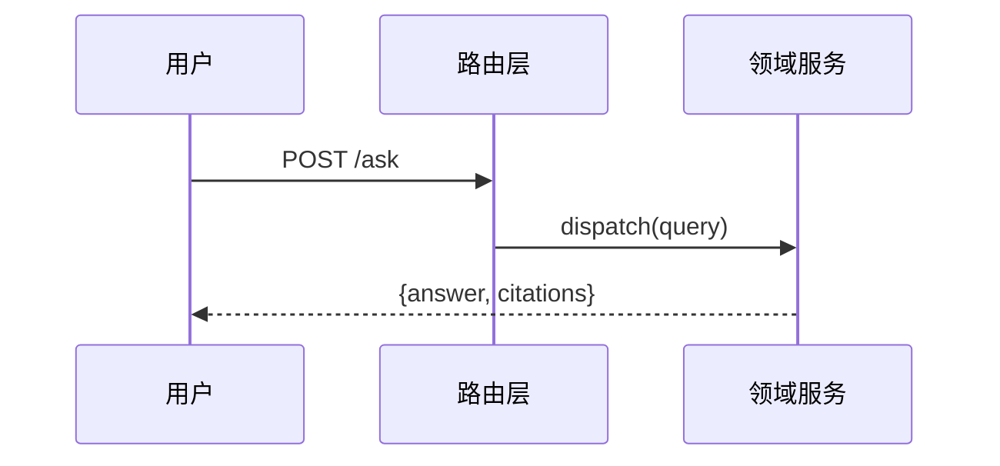

# AGENTS.md / CLAUDE.md 模板与知识落盘规范

## 目录结构（Progressive Disclosure）

```
project-root/
├── AGENTS.md                # 唯一来源：技术栈+命令+全局规则+索引（~70-90 行）
├── CLAUDE.md                # Claude Code 入口：@AGENTS.md 导入桩 + Claude 专属（< 30 行）
├── openwiki/                # 内置代码 wiki 构建器产出的代码 wiki（见 code-wiki-builder.md）
├── docs/
│   ├── context-gap-report.md    # 上下文缺口诊断报告（Phase 0 产出）
│   ├── runtime-truth.md         # 跨模块硬知识：关键决策/运行时真相/已下线/技术债
│   ├── conventions/
│   │   ├── module-boundaries.md # 模块边界：场景外壳 + 共享能力层
│   │   ├── contracts.md         # 接口契约：通信协议、状态机、版本演进
│   │   ├── coding-style.md      # 编码规范：命名、目录、错误处理模式
│   │   └── agent-rules.md       # AI 代理行为准则（Karpathy 十条）
│   ├── architecture/
│   │   └── dependency-map.md    # 依赖显化图谱（codegraph 导出 或 手工归纳，注明来源）
│   ├── testing.md               # 测试策略、Mock 规范、fixtures 说明
│   └── ops.md                   # 部署配置、环境变量、三方依赖对接
└── src/
    ├── core/
    │   ├── AGENTS.md           # 核心模块：架构契约 + 状态机约定
    │   └── CLAUDE.md           # 指针桩：@AGENTS.md（Claude Code 沿目录自动注入）
    ├── feature-a/
    │   ├── AGENTS.md           # 业务模块：领域术语 + 核心链路 + 历史决策
    │   └── CLAUDE.md           # 指针桩：@AGENTS.md
    └── feature-b/
        ├── AGENTS.md           # 业务模块：接口版本 + 兼容策略
        └── CLAUDE.md           # 指针桩：@AGENTS.md
```

## 根目录 AGENTS.md 模板（运行必需 + 索引，~70-90 行）

> AGENTS.md 是**唯一上下文来源**：Codex/Cursor/Jules 等只读本体系，不读 CLAUDE.md。
> 顶部放运行必需（技术栈/命令），再放全局规则，最后是索引；深度细节下沉模块/docs。

```markdown
# <项目名> — AI 知识索引

## 技术栈
<语言 / 框架 / 构建 / 包管理 / 测试框架，1-2 行>

## 常用命令
- 构建：...
- 测试：...（若无测试脚本期注明，指向 docs/testing.md）
- Lint / 格式化：...
- 本地运行：...

## 领域知识
- `src/core/AGENTS.md`：系统核心架构、状态管理约定、模块通信协议
- `src/feature-*/AGENTS.md`：各业务域的领域术语、核心链路、历史决策
- `openwiki/`：结构化领域 wiki（如已生成）

## 工程规范
- `docs/runtime-truth.md`：跨模块硬知识（关键决策/运行时真相/已下线清单/技术债）
- `docs/conventions/coding-style.md`：编码规范、命名约定、目录组织原则
- `docs/conventions/contracts.md`：模块间接口契约与版本兼容策略
- `docs/conventions/module-boundaries.md`：场景外壳 / 共享能力层边界
- `docs/conventions/agent-rules.md`：AI 代理行为准则（Karpathy 十条）
- `docs/testing.md`：测试策略、Mock 规范、fixtures 说明

## 运行环境
- `docs/ops.md`：部署配置、环境变量、三方依赖对接信息

## 全局规则
- <项目级硬性规则，如 commit message 格式要求>

### AI 代理行为准则（Karpathy 编码规则）
> 完整版见 `docs/conventions/agent-rules.md`。以下为速查精简版——每条都是踩坑后的铁律：

- **先读再写**：动手前读懂目标文件、同类实现、import、测试，不凭训练记忆硬生成
- **想清再码**：显式陈述假设、点明权衡、困惑即停，不静默猜测
- **够用即止**：写刚好解决眼前问题的最少代码；抵制过度抽象、投机式容错、无谓可配置
- **手术刀式改动**：只动被要求动的地方，匹配既有风格，不顺手"清理"无关代码
- **验证而非臆测**：改 bug 先写复现测试，改前改后都跑既有测试，测不了就直说
- **目标驱动**：把模糊任务转成可验证标准，多步任务先列计划再执行
- **调试不猜**：读完整报错与栈、先复现、每次只改一处、不绕开根因
- **审慎依赖**：能复用现有库 / 标准库就不引新包，引入必须说明理由
- **有效沟通**：说清做了什么为什么、主动暴露隐患、精确表达不确定处
- **规避十类失败模式**：Kitchen Sink、错误抽象、隐形决策、乐观路径、知识幻觉、风格漂移、失控重构……

## 知识落盘规范
- 根 AGENTS.md 放运行必需 + 索引（不堆深度细节）；CLAUDE.md 只是 `@AGENTS.md` 导入桩，**不承载任何关键内容**
- 任何关键上下文（命令/决策/运行时真相/已下线）只能落 AGENTS.md 体系，**绝不只放 CLAUDE.md**——否则 Codex/Cursor 看不到
- 对话中出现的可复用规则/兼容性结论/排障结论/项目知识，必须就近落盘到对应模块 AGENTS.md，并同步更新根索引（以模块内容为准）
- 发现索引内容过期或不准确时，主动修正
- 架构调整/规范变更/接口升级，必须在同一 MR 中同步更新对应 AGENTS.md
```

## CLAUDE.md 模板（导入桩，< 30 行）

> CLAUDE.md 不再承载任何 agent 关键内容——它只是一行 `@AGENTS.md` 导入 + Claude Code 专属补充。
> 所有上下文以 AGENTS.md 为唯一来源：避免双份维护漂移，避免 Codex/Cursor 看不到。

```markdown
# <项目名> — Claude Code 入口

<!-- 本项目以 AGENTS.md 为唯一上下文来源（跨 Coding Agent 标准）。
     Claude Code 通过下面这行加载全部内容，无需重复维护。 -->
@AGENTS.md

## Claude Code 专属（可选，仅放 Claude Code 才用的）
- <本项目用 pnpm；改动前先读 AGENTS.md 索引。>
- <slash 命令 / skill 触发词 / hooks 提示>
```

## 模块级 CLAUDE.md 指针桩（与每个模块 AGENTS.md 配对）

> 根 CLAUDE.md 之外，**每个放了 AGENTS.md 的模块目录再放一个 CLAUDE.md**，内容仅一行 `@AGENTS.md` + 注释。
> **为什么**：Claude Code 沿目录层级自动加载 CLAUDE.md（编辑 `src/foo/x.ts` 时会向上找各层 CLAUDE.md），但**不自动加载 AGENTS.md**。配对桩让 Claude Code 自动注入对应模块文档，而无需 agent 主动跟根索引去读。AGENTS.md 仍是唯一内容来源——桩零内容，只有 AGENTS.md 改名/移动时才需同步改路径，无内容漂移风险。Codex/Cursor 不受影响（它们原生读 AGENTS.md）。

```markdown
<!-- 指针桩：本模块上下文以同目录 AGENTS.md 为唯一来源。Claude Code 沿目录层级自动加载本文件，经 @AGENTS.md 注入模块文档。请勿在此写内容——改 AGENTS.md。 -->
@AGENTS.md
```

> 落盘纪律：每新增一个模块 AGENTS.md，同目录补一个 CLAUDE.md 指针桩；AGENTS.md 改名/移动时同步改桩。收尾清单据此核对：**CLAUDE.md 桩数 = AGENTS.md 数**。

## docs/runtime-truth.md（跨模块硬知识）

跨模块、不属于单一模块的全局硬知识落这里，并在根 AGENTS.md 工程规范索引指向。**不要塞进 CLAUDE.md**（Codex/Cursor 读不到）。模块特有的知识仍就近落模块 AGENTS.md；本文件只收**全局性**的：

- **关键架构决策**：决策 + 一句话原因 + 日期
- **运行时真相**：静态分析看不出的（环境分支、硬编码耦合、未验证假设、新旧链路并存）
- **已下线 / 已废弃清单**：防 AI 误用死代码 / 废弃 API（每条标注"已移除 / 待清理 / 暂保留"）
- **技术债务现状**：改造做了一半的模块、临时方案转正的副作用

## 模块级 AGENTS.md 模板

```markdown
# <模块名>

## 职责
<这个模块管什么、不管什么（边界）>

## 领域术语
| 术语 | 含义 |
|---|---|
| ... | ... |

## 核心链路
<入口 → 关键调用路径 → 出口；标注与其他模块的契约点>

## 状态机 / 协议约定
<如适用>

## 历史决策与排障记录
- <日期>：<决策/结论 + 依据>（对话中沉淀的可复用知识追加在这里）

## 注意事项（AI 易踩坑）
- <易误判点，如"看似无引用实则为反射调用">
```

## docs/conventions/agent-rules.md（AI 代理行为准则）

由本 skill 的 `assets/agent-rules.md`（Karpathy 十条编码规则）落盘生成，是项目 AI 代理的行为底线。**正文默认保留原文**（权威、可检索），团队可在各章追加"本项目补充：…"而不要删改原条目。根 AGENTS.md 的"全局规则"节只放十条的中文速查版 + 指向本文件的链接，遵循 Progressive Disclosure。

> 与各模块 `AGENTS.md` 的"注意事项（AI 易踩坑）"互补：本文件讲通用纪律，模块文件讲该模块特有的坑。

## 代码 Wiki 模板组（openwiki/ 目录，内置构建器产出）

> 配合 [code-wiki-builder.md](code-wiki-builder.md) 使用——那里讲"怎么建"，这里给"长什么样"。
> 每个概念页顶部必须有 OKF front matter；正文按页型填充。目录边界跟随仓库真实组件/领域，不要镜像目录树。

### OKF front matter（每个概念页顶部）

```yaml
---
type: Service                       # 必填。自由类：Service / API Endpoint / Domain Concept / Workflow / Runbook / Data Model
title: <显示名>
description: <1-2 句，检索优化>
resource: src/path/to/canonical.ts  # 底层资产路径
tags: [domain-facet]
openwiki:                           # evidence-backed 时才填，不编造
  roles: [domain, workflow]         # architecture/delivery/domain/integration/operations/repository/testing/workflow
  source_paths: [src/...]
  symbols: [PublicSymbol]
  test_paths: [tests/...]
  invariants: [可观测契约]
  validation_commands: [最窄非破坏性检查]
---
```

### quickstart.md（入口页，最后写）

- `# <项目名> quickstart`：项目是什么、解决什么问题，2-3 句
- `## 总览`：主要系统/模块各自一句话，每条链向对应概念页
- `## 任务路由表`：本页灵魂——紧凑表格，列见下
- `## 文档地图`：链向 architecture / domain / workflows / operations
- `## Backlog`：evidence-blocked 的延期项，每条带 source anchor + 一句原因

**任务路由表**（`quickstart.md` 必含）：

| 变更意图 | 相关 wiki 页 | source entry points | 关键 symbols | focused tests | 最小验证命令 |
|---|---|---|---|---|---|
| 加一个 API 端点 | [workflows/request-flow.md](workflows/request-flow.md) | src/server/routes.ts | registerRoute | tests/routes/*.test.ts | `pnpm test routes` |
| 改领域模型 | [domain/order.md](domain/order.md) | src/domain/order.ts | Order, OrderStatus | tests/domain/order.test.ts | `pnpm test order` |

路由的是真实存在的变更类别（源码/历史支持），source 用稳定路径与符号名（不用行号），验证命令给最窄非破坏性检查。

### architecture/overview.md（运行时结构）

- `## 分层结构`：运行时分层（如 CLI → 服务 → 领域 → 持久化），每层链向代表模块
- `## 运行时形状`：一次请求/一次启动如何流经各层，用 `sequenceDiagram` 画
- `## 为什么这样设计`：关键架构决策 + 一句话原因（与 `docs/runtime-truth.md` 呼应）
- `## 扩展点`：加新 provider / 新 API / 新领域模型时动哪里

### domain/&lt;概念&gt;.md（业务概念页）

- `## 职责`：管什么、不管什么（边界）
- `## 领域术语`：术语表
- `## 核心链路`：入口 → 关键调用 → 出口，标注契约点（用 `flowchart`/`sequenceDiagram`）
- `## 状态机 / 生命周期`：如适用，用 `stateDiagram-v2`
- `## 不变量`：可观测契约，每条链到能证明它的测试
- `## 关系`：动词短语链接相关概念（dispatches to / depends on / is persisted by）
- `## 改动指引`：改这里动哪些 symbols、跑哪些 focused tests、注意什么坑

### workflows/&lt;链路&gt;.md（运行时链路）

- `## 触发与入口`：谁触发、从哪个 entrypoint 进
- `## 流程`：完整调用序列，每个 participant 由源码支撑，用 `sequenceDiagram`
- `## 涉及组件`：链向本链路经过的各概念页
- `## 失败与边界`：异常分支、重试、降级

Mermaid 示例（grounded in source 才画）：



> 写完自检 Mermaid 语法（缩进、`end` 配对、节点名无特殊字符）；不确定就退化为带缩进的文字描述——坏图比没图更糟。

## 知识保鲜机制

1. **变更驱动更新**：任何架构调整、规范变更、接口升级，同一 MR 内同步更新 AGENTS.md——写进 MR 检查清单。
2. **定期巡检（上下文漂移报告）**：每月运行一次扫描——对比近期代码变更与各 AGENTS.md 内容，产出差异报告，人工确认后批量修正；同时按 [code-wiki-builder.md](code-wiki-builder.md) §9 增量刷新 `openwiki/` 代码 wiki（读 `.last-update.json` 取 gitHead → `git log <head>..HEAD` 算变更窗口 → docs impact plan，无变更则 no-op）。openwiki CLI 可用时亦可 `openwiki code --update --print` 替代并自动开文档 PR。
3. **就近落盘**：对话产生的知识落盘到离它最近的模块文件，而不是根目录。

## 上下文漂移报告模板（巡检模式产出）

```markdown
# 上下文漂移报告 — <项目名>
> 巡检日期：<date> ｜ 对照区间：<起始 commit/日期> → <当前>
> 核对范围：<N> 份文档 / <M> 条事实性陈述

## 过期项（文档与代码矛盾，已修正 ✅ / 待人工确认 ⏳）
| # | 严重度 | 文档位置 | 文档陈述 | 代码现实 | 处置 |
|---|---|---|---|---|---|
| 1 | 高 | src/core/AGENTS.md:12 | "结算走 V2 定价" | calc() 仍可按 env 回退 V1 | ✅ 已修正（依据 commit a1b2c3） |
| 2 | 高 | README.md | "支持 App 客户端" | legacy-client-compat.js 已删除 | ✅ 已修正 |

（严重度参考：高 = 会误导 AI 做出错误操作；中 = 描述过时但不导致错误动作；轻 = 细节不准）

## 缺失项（新代码无文档覆盖）
| # | 代码位置 | 变更内容 | 建议落盘位置 |
|---|---|---|---|
| 1 | src/coupon/ | 新增优惠券模块，无 AGENTS.md | src/coupon/AGENTS.md |

## 健康项（核对无误）
- docs/conventions/contracts.md：接口契约 8 条全部仍成立
- ...

## 人工确认清单
- <无法从代码证实的运行时真同类问题，如线上配置值>

## 保鲜机制复盘
<漂移为什么会发生？逐条追溯：哪次代码变更没有执行"同 MR 更新文档"规则？
例如：compat 层删除、coupon 上线、定价收敛三次变更均未同步文档 →
建议把"同 MR 更新 AGENTS.md"写进 MR 模板检查清单 / CI 校验>
```
